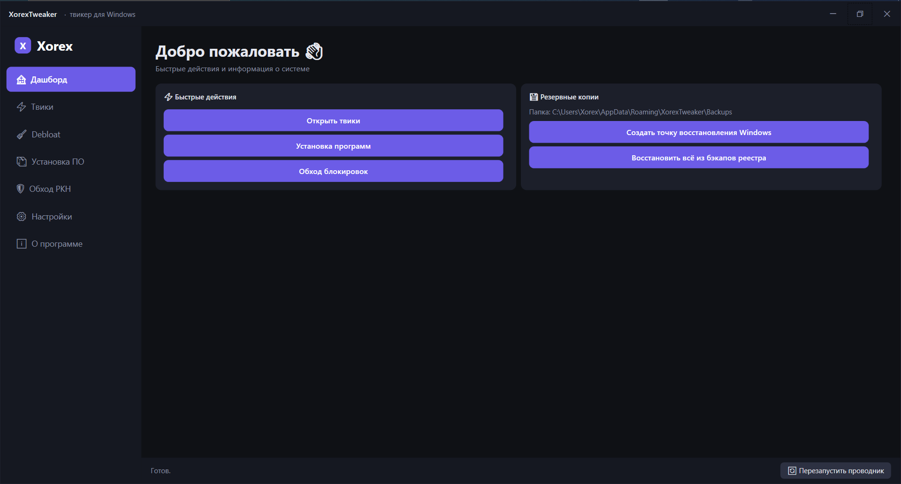
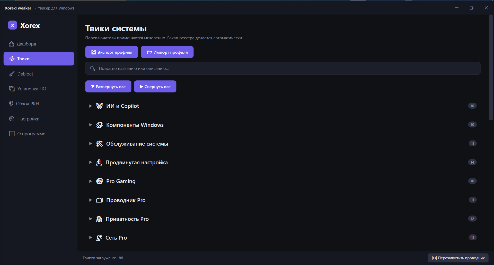
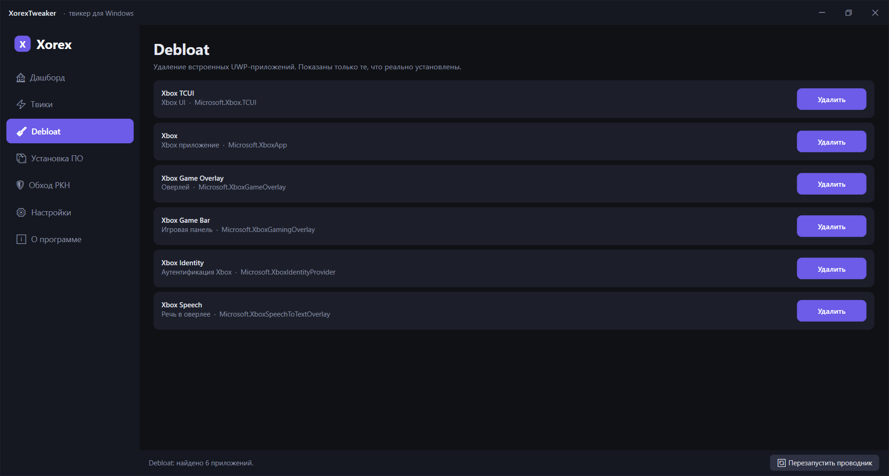
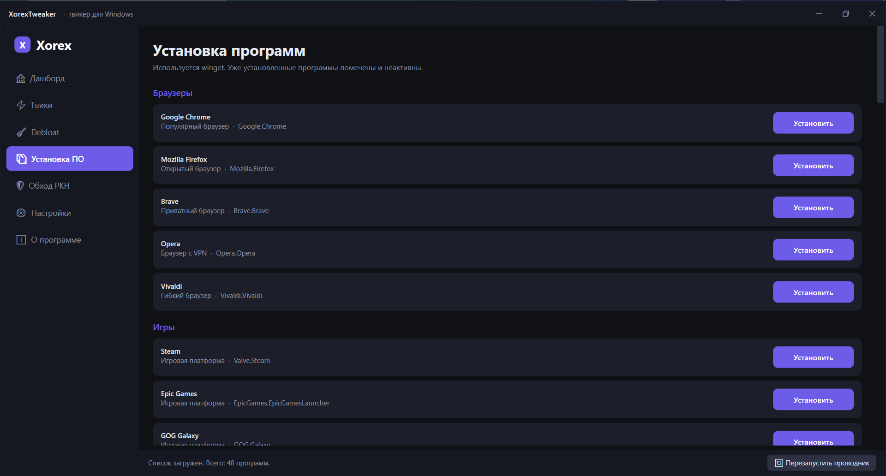

<div align="center">


# XorexTweaker

**Твикер для Windows 10/11, который действительно работает.**

200+ твиков в 24 категориях · Debloat · Установка ПО · Обход РКН · Всё в одном приложении

[](#)
[](#)
[](LICENSE)
[](../../releases/latest)
[](../../releases)

[🌐 Сайт](https://xorextweaker.xo.je) · [📥 Скачать](../../releases/latest) · [🐛 Сообщить о баге](../../issues) · [💛 Поддержать](#-поддержать-автора)

---

</div>

## 📸 Скриншоты

<div align="center">

| Дашборд | Твики |
|:---:|:---:|
|  |  |

| Debloat | Установка ПО |
|:---:|:---:|
|  |  |

</div>

## ✨ Что умеет

### ⚡ 200+ твиков в 24 категориях
- 🔒 **Приватность и телеметрия** — DiagTrack, рекламный ID, Cortana, сбор данных
- ⚡ **Производительность** — HAGS, приоритеты CPU, SystemResponsiveness, Ultimate Performance
- 🎮 **Геймерские** — Game DVR, Xbox-службы, GPU Priority, FSE-оптимизации
- 🎯 **Pro Gaming** — Nagle off, HPET, Dynamic Tick, MPO, Spectre/Meltdown отключение
- 🌐 **Сеть и интернет** — TCP NoDelay, DefaultTTL, отключение IPv6, QoS
- 📡 **Сеть Pro** — смена DNS (Cloudflare/Google/Quad9/AdGuard), LLMNR off, оптимизация NIC
- 🎨 **Интерфейс** — тёмная тема, старое контекстное меню, секунды в часах
- 🗂️ **Проводник Pro** — полный путь в заголовке, скрытие Галереи, компактный режим
- 📁 **Проводник** — расширения файлов, скрытые файлы, быстрый доступ
- ⚙️ **Службы Windows** — Windows Search, DiagTrack, Remote Registry, WerSvc
- 💾 **SSD и диски** — Prefetch, TRIM, last access time, авто-дефраг
- 🔄 **Обновления Windows** — автообновление, драйвера, уведомления
- 🔌 **Питание** — гибернация, Power Throttling, USB suspend, быстрый запуск
- 🛡️ **UAC и безопасность** — SmartScreen, AutoRun, уровень UAC
- 🤖 **ИИ и Copilot** — отключение Copilot, Recall, Click to Do, AI в Paint/Notepad/Edge
- 🧩 **Компоненты Windows** — Hyper-V, WSL, .NET 3.5, Sandbox, Telnet, NFS
- 🛠️ **Обслуживание системы** — SFC, DISM, сброс Windows Update, перерегистрация Store
- 🔬 **Продвинутая настройка** — CSRSS priority, NUMA, Memory Management
- 🕵️ **Приватность Pro** — рукописный ввод, речь, CEIP, Error Reporting
- 🚫 **Реклама и контент** — Suggested Apps, реклама в Параметрах, подсказки
- 🔊 **Звук** — системные звуки, ducking, стартовый звук
- 🖱️ **Мышь и клавиатура** — ускорение мыши, залипание клавиш
- 🔤 **Шрифты и DPI** — ClearType, гамма шрифтов
- 🌍 **Edge и Bing** — предзагрузка, Startup Boost, фон Edge

### 🧹 Debloat
Удаление встроенных UWP-приложений с автоопределением — показывает только то, что реально установлено на ПК. Одно нажатие — чисто.

### 📦 Установка программ
48 популярных программ в один клик через **winget**. Уже установленные помечаются и блокируются. Не надо искать, качать, ставить — просто отмечаешь галочками.

### 🛡️ Обход блокировок
Встроенная поддержка **Zapret** с авто-скачиванием последней версии. Один клик — обход РКН для Discord, YouTube и GitHub.

### 💾 Безопасность
- **Автобэкап реестра** перед каждым твиком
- **Точки восстановления Windows** в один клик
- **Профили** — сохрани набор твиков в `.xtweak` файл и примени на другом ПК
- **Подтверждение для опасных твиков** — не сломаешь систему случайно

### 🎨 Интерфейс
- Тёмная тема в стиле Windows 11
- Кастомный title bar с плавными анимациями
- Поиск по твикам
- Аккордеон-категории
- Настройки с сохранением в JSON
- Проверка обновлений через GitHub API

## 📥 Установка

### Способ 1: Portable .exe (рекомендуется)

1. Скачай последний релиз со страницы [Releases](../../releases/latest)
2. Запусти `XorexTweaker.exe`
3. Согласись на запрос администратора

**Ничего устанавливать не нужно.** Все зависимости встроены в `.exe`. Работает на Windows 10 (1809+) и Windows 11.

### Способ 2: Portable-режим (настройки рядом с приложением)

Хочешь носить твикер на флешке вместе с настройками?

1. Положи `XorexTweaker.exe` в любую папку
2. Создай рядом пустой файл `portable.txt`
3. Запусти — настройки и бэкапы будут в папке `UserData/` рядом с `.exe`

## ⚠️ Возможные проблемы

### Windows SmartScreen предупреждает
> «Windows защитила ваш компьютер»

Это **нормально** для любого `.exe` без цифровой подписи. Жми **«Подробнее» → «Выполнить в любом случае»**.

Цифровая подпись стоит от 300$ в год — пока проект не окупается, её не будет. Код полностью открыт, можешь проверить.

### Антивирус ругается
Твикер правит реестр, отключает службы, работает с PowerShell — **это красная тряпка для антивирусов**. Возможны ложные срабатывания.

Проверь код на [VirusTotal](https://www.virustotal.com), если есть сомнения. Исходники — на GitHub.

### Не запускается на старой Windows 10
Установи [Visual C++ Redistributable 2015-2022](https://aka.ms/vs/17/release/vc_redist.x64.exe) — обычно он уже встроен в систему, но на старых сборках может отсутствовать.

### GitHub не открывается
Это блокировки РКН. Используй **Zapret** — инструкция в [разделе «Обход РКН»](https://xorextweaker.xo.je#bypass) на сайте.

## 🛠 Сборка из исходников

**Требования:** [.NET 10 SDK](https://dotnet.microsoft.com/download/dotnet/10.0)

```bash
git clone https://github.com/XorexMod/XorexTweaker.git
cd XorexTweaker
dotnet restore
dotnet run --project XorexTweaker/XorexTweaker.csproj
